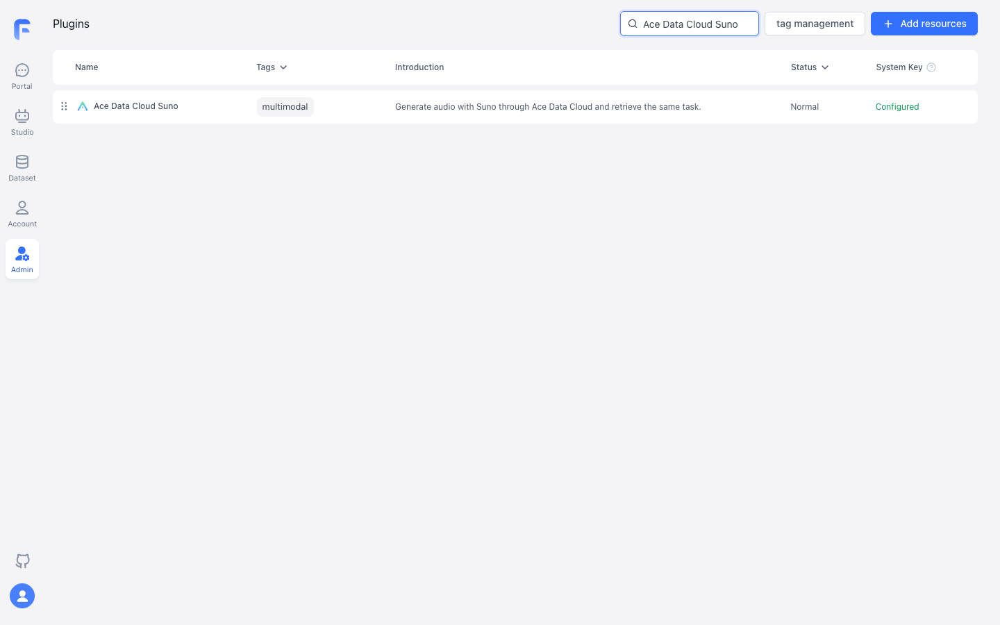
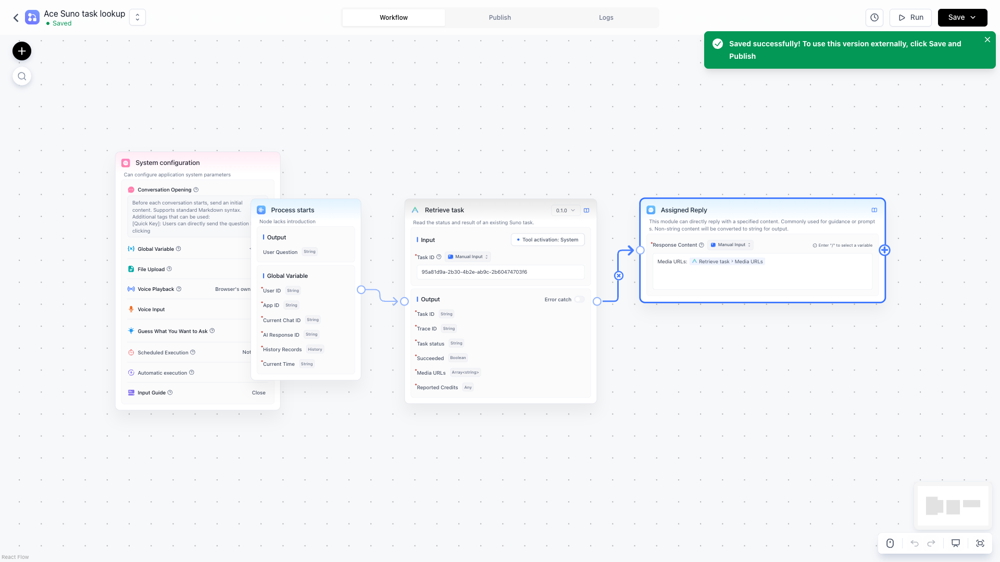
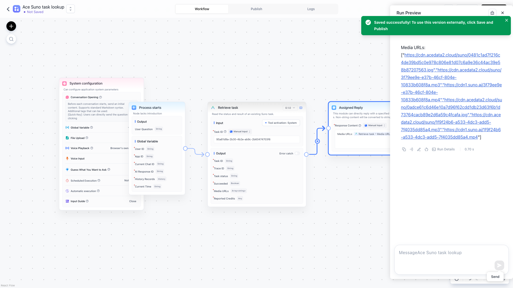

# Suno by Ace Data Cloud for FastGPT

This independent plugin is maintained by **Ace Data Cloud** and uses your Ace application API token. It integrates Suno; it is not an official Suno or FastGPT plugin.

Generate Suno music and retrieve the result in a FastGPT workflow. [简体中文](README_zh_CN.md) · [Current pricing](https://platform.acedata.cloud/models?utm_source=opensource&utm_medium=referral&utm_campaign=evergreen&utm_content=sunofastgpt_readme_pricing)

## Quick start

### 1. Install

[Official FastGPT plugin Marketplace](https://cloud.fastgpt.io/config/tool/marketplace) · [Current listing review](https://github.com/labring/fastgpt-community-plugins/pull/74). This candidate is not listed yet; the review link is not an install button.

Use FastGPT 4.15 or later. This service is not listed in the official Marketplace yet. When approved, search for **Suno by Ace Data Cloud** and verify the author is **Ace Data Cloud**.

For a current administrator installation, download the [published .pkg and checksum](https://github.com/AceDataCloud/SunoFastGPT/releases/tag/v0.2.2). A system administrator can upload it through plugin management. A **team administrator or owner** can also upload/confirm a .pkg in **Tools → Add plugin → Upload plugin** if the system administrator has enabled **team plugin uploads**. That switch also controls team Marketplace installation; an ordinary team member cannot install plugins. Team and system installations use separate credentials.

This is the [current official team-installation mechanism](https://github.com/labring/FastGPT/blob/main/document/content/plugin/team-installation.mdx), read on 2026-10-19. Availability on a particular Cloud workspace depends on its plan, current version, enabled features and your role; do not create another account merely because an upload control is missing. Ask that workspace's administrator which existing role/setting applies. A local/team upload is private to that installation/team and does not establish public Marketplace listing.

Third-party provider listing requires a separate cooperation application under the [maintainer's current guidance](https://github.com/labring/FastGPT/pull/8017#issuecomment-6257574098). Published GitHub packages are not an endorsement or official market admission.

### 2. Get an API key

New account? Register and sign in first. If General application is missing, choose **Initialize General Application** in Applications. This token belongs to Ace Data Cloud, not your FastGPT login.

Sign in to [Ace Data Cloud → Applications](https://platform.acedata.cloud/console/applications?utm_source=opensource&utm_medium=referral&utm_campaign=evergreen&utm_content=sunofastgpt_readme_api_key), open **General Application**, and confirm **Suno** access, balance, and current price. Copy the key using icon **1** below; or select **2 Manage Keys → Create** for a separate FastGPT key. If **Allowed APIs** is enabled, include both /suno/audios and /suno/tasks. In the FastGPT plugin configuration, paste only the key into **Ace Data Cloud API key**, without Bearer or quotes.

To create an optional dedicated token, choose **Manage Keys → Create**, give it a name such as `FastGPT Suno`, set only the expiration and API restrictions you need, then create and copy it. Use the service and task paths listed above.

This is a real Ace Console screenshot reused from the [Suno Dify source guide](https://github.com/AceDataCloud/SunoDify/blob/8d3d03570e73324220f111f7fe343da0792a8071/README.md), 2026-10-08/09. The image uses the example name `Dify tutorial`; use your own FastGPT token name. No live credential is shown.

### 3. Build the first workflow

In **Studio → Create Agent → Workflow**, start with **Process starts**. From **System Tools**, add **Suno by Ace Data Cloud / Generate Suno music** and **Retrieve Suno task**. Activate both tools with the configured **System secret**. Connect **Process starts → Generate Suno music → Retrieve Suno task → Basic / Assigned Reply**. Enter:

| Generate field | First-run value |
|---|---|
| Model | chirp-v6 |
| Instrumental | true |
| Duration | 10 |

**Prompt**: A short gentle instrumental piano melody for a sunrise, no vocals.

For **Retrieve Suno task → Task ID**, choose **Variable Reference → Generate Suno music → Task ID**. In **Assigned Reply**, insert the Retrieve Suno task outputs (status, success, taskId, mediaUrls, and costCredits) with the variable picker. Choose **Save Only**, then **Run Preview** once. If status is pending, save taskId. To check later, create a separate **Process starts → Retrieve Suno task → Basic / Assigned Reply** workflow and enter that same ID. Running the generation workflow again submits and bills another generation.

When status is succeeded and success is true, open a link from mediaUrls. Match the task ID and reported Credits with Ace Data Cloud request history; pricing and your package exchange rate may change.

The FastGPT screenshots below show installation and a **read-only query of a previously generated task**. They do not show a new FastGPT generation.

For several existing tasks, **Retrieve Suno tasks** accepts 1–20 Task IDs and queries them in one read-only call. Check each item’s status; a batch is complete only when all items succeed. This does not submit new generation.

A batch stays pending if a requested task is missing or a returned task ID cannot be matched. Verify the existing IDs; do not submit generation again.

### 4. Copyable no-key example

[examples/generate.json](examples/generate.json) contains no credentials. Create a local .secrets.local.json containing {"apiKey":"YOUR_OWN_KEY"}, then:

~~~sh
pnpm install
pnpm exec fastgpt-plugin debug . --run --tool generate --input-file examples/generate.json --secrets-file .secrets.local.json
pnpm exec fastgpt-plugin build --entry . --output ./dist
pnpm exec fastgpt-plugin check --entry . --output ./dist
pnpm exec fastgpt-plugin pack --entry . --dist ./dist --output ./out
~~~

For a pending result, create a local examples/retrieve.local.json with {"taskId":"THE_RETURNED_TASK_ID"}. Use the same secret file and run only:

~~~sh
pnpm exec fastgpt-plugin debug . --run --tool retrieveTask --input-file examples/retrieve.local.json --secrets-file .secrets.local.json
~~~

Local secret files are ignored by Git. Do not publish them.

| What you see | What to do |
|---|---|
| 401 / 403 | Check key, expiration, Suno access, Allowed APIs, and balance. |
| 400 | Start with the exact first-run fields and inspect the rejected parameter. |
| pending / no media | Query only the same task ID later. |
| 429 | Wait and lower concurrency; never enable automatic paid generation retries. |
| timeout / 5xx / failed | Inspect the original task and request history before resubmitting. Give support the task or trace ID, never your key. |

The plugin sends the selected inputs and token to api.acedata.cloud. Calls follow [current pricing](https://platform.acedata.cloud/models?utm_source=opensource&utm_medium=referral&utm_campaign=evergreen&utm_content=sunofastgpt_readme_pricing). [Privacy](PRIVACY.md) · [Source and support](https://github.com/AceDataCloud/SunoFastGPT/issues).

## Screenshot scope

FastGPT screenshots below/above are real self-hosted FastGPT 4.15.8 test captures from 2026-10-09. They show the earlier display names and plugin 0.1.0. Current 0.2.2 service-first names and Marketplace installation are not established by those historical images.
